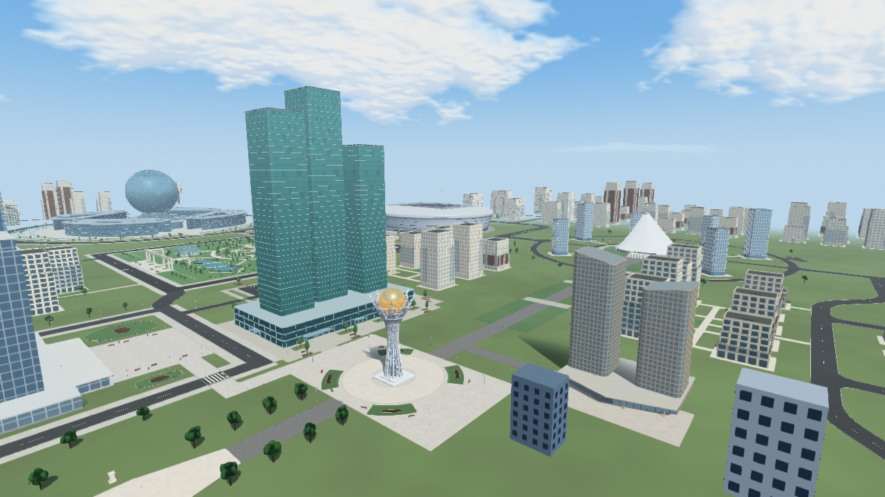
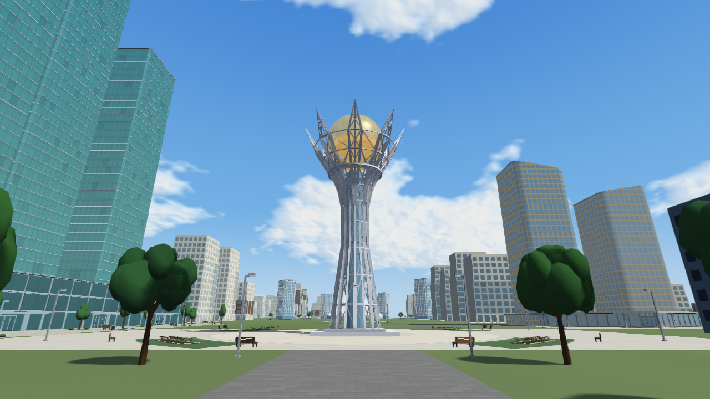
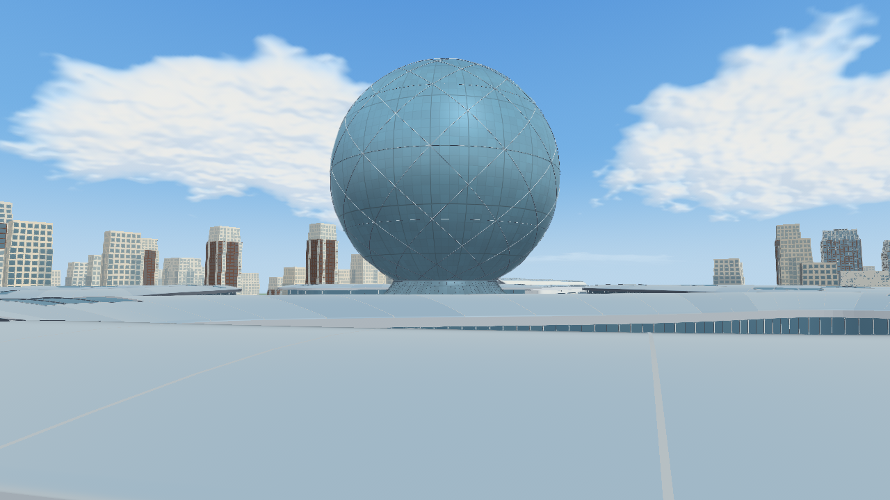
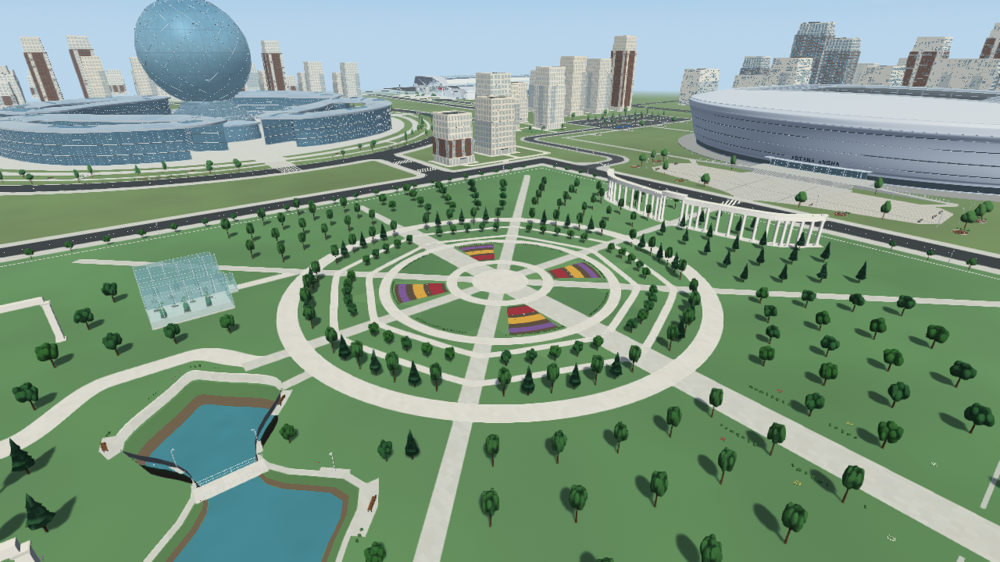
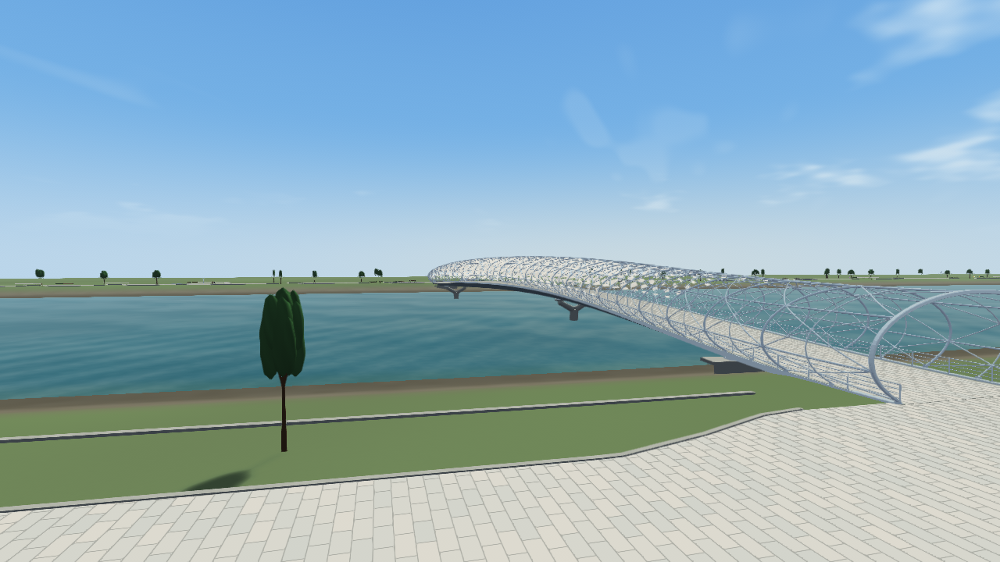
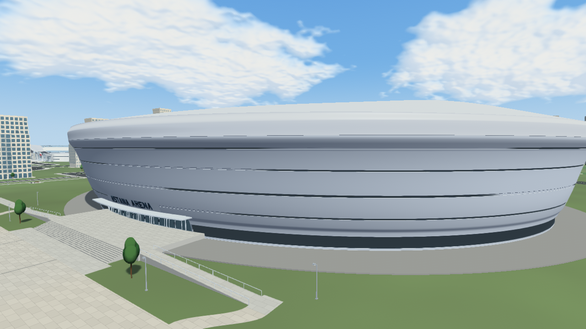
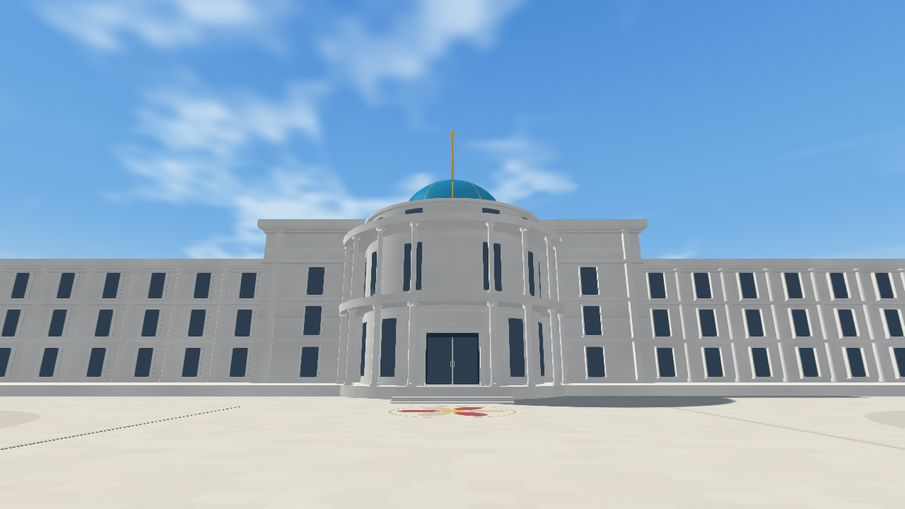

<div align="center">

# 3D TOUR TO ASTANA

### An Interactive 3D Exploration of Kazakhstan's Capital


**Astana IT University · Computer Graphics Fundamentals · 2026–2027**

[Showcase](#visual-showcase) · [Landmarks](#landmarks-and-districts) · [Controls](#keyboard-and-mouse-controls) · [Build & Run](#build-and-run) · [Rendering](#graphics-and-rendering-pipeline)

</div>

## Project Overview

**3D Tour to Astana** is a completed university final project: an interactive walkthrough and fly-over of Astana, Kazakhstan, built with C++17 and a custom OpenGL 3.3 Core renderer. Explore recognizable landmarks, walk through landscaped public spaces, or take flight to view the city's expanding skyline.

The environment brings together procedurally constructed architecture, residential neighborhoods, connected streets, gardens and the Esil riverfront. Daylight, local cast shadows, cinematic clouds, animated water and layered vegetation give the city a coherent real-time presentation.

The project applies computer graphics fundamentals through model/view/projection transformations, indexed meshes, GLSL shading, framebuffer rendering and interactive camera control. It is an exploration experience: the focus is the city and its rendering, with no missions, scoring or game-over mechanics. World scale is approximately **1 OpenGL unit = 1 meter**; the layout is a stylized interpretation rather than a geographically exact city model.

## Visual Showcase



*A city-scale view connecting recognizable architecture, residential development and public spaces.*

| Baiterek and the central district | EXPO / Nur Alem |
| :---: | :---: |
| [](docs/screenshots/baiterek.png) | [](docs/screenshots/expo-nur-alem.png) |
| **Botanical Garden** | **Esil River / Atyrau Bridge** |
| [](docs/screenshots/botanical-garden.png) | [](docs/screenshots/esil-atyrau-bridge.png) |
| **Astana Arena** | **Ak Orda** |
| [](docs/screenshots/astana-arena.png) | [](docs/screenshots/ak-orda.png) |

All images are unaltered **1280×720 application captures**, copied into this repository's screenshot directory. Skyline, Baiterek, EXPO and Arena images come from the [G7F sky validation](docs/GraphicsG7F.md); the garden comes from [G9B vegetation validation](docs/GraphicsG9B.md), and the river/palace views from the [G10A audit](docs/GraphicsG10A.md). They document different completed graphics stages, so cloud appearance varies. No external architectural reference images are presented as application output. Click gallery images for full resolution.

## Key Features

| Area | Implemented features |
| --- | --- |
| **Exploration** | Custom mouse-look camera, walking and free flight, sprint/turbo speeds, smooth return to walking and eight landmark teleport viewpoints. |
| **Procedural city** | Landmark modules, premium and background residential districts, commercial architecture, road networks, plazas, parking and landscaped public spaces. |
| **Daylight and shadows** | Warm directional sunlight, cool hemispherical ambient fill and one local, filtered directional shadow map with stabilized projection and cached updates. |
| **Sky and atmosphere** | Default cinematic daytime sky, visible solar disc/glow, cached procedural cloud fields, distance haze and an optional anime sky mode. |
| **Surface materials** | Procedural grass/asphalt/paving, differentiated stone/brick/metal shading, view-dependent glazing and animated blue-green river/decorative water. |
| **Final image** | Reusable floating-point scene framebuffer, controlled tone mapping/color balance and independently switchable FXAA in the same composite. |
| **Vegetation** | Shared deciduous/conifer tree models with three LODs, upgraded low vegetation and camera-local grass detail on selected classified lawns. |
| **Interaction and HUD** | Resizable help/status panels, project/team identification, animation pause, sunlight rotation/reset and FPS/frame-time status in the window title. |
| **Optimization** | Shared residential archetypes, GPU instancing, three background-building LODs, group/cell frustum culling, material batching and cached EXPO/MEGA glass sorting. |

These optimizations are module-specific; the renderer does not claim universal instancing or whole-scene culling. See the [graphics audit](docs/GraphicsG10A.md) for the remaining legacy submission costs.

## Landmarks and Districts

| Landmark / area | What to explore |
| --- | --- |
| **Baiterek** | The central monument, golden sphere, structural supports and surrounding plaza. |
| **Northern Lights / Severnoye Siyaniye** | Three turquoise-glass towers, horizontal silver bands, shared commercial podium and entrances. [Development record](docs/NorthernLights.md) |
| **Talan Towers** | Twin towers, podium/gallery frontage and architectural glazing. |
| **Abu Dhabi Plaza** | The multi-tower complex and its surrounding landscaping. |
| **Ak Orda** | Palace facade, portico, blue dome, ceremonial gardens and fountains. |
| **Khan Shatyr** | Tent-shaped architecture, mast/cable structures and the surrounding developed district. |
| **Botanical Garden** | Curved colonnade, geometric paths, parterres, water, greenhouse and planted areas. |
| **Astana Arena** | Silver shell, detailed static retractable-roof assembly, main entrance, stairs/ramps, football pitch and two-tier bowl with **27,644 instanced seats**. [Stadium record](docs/AstanaArena.md) |
| **EXPO / Nur Alem** | Spherical museum, pavilions, canopy structures and nearby EXPO residential developments. |
| **MEGA Silk Way** | Shopping-center architecture, glass areas and parking surroundings. |
| **Esil River / Atyrau Bridge** | Recessed water, two landscaped promenades, viewing spaces and the bridge's lattice canopy with **818 architectural panels**. [Riverfront record](docs/EsilRiverDistrict.md) |
| **Residential city fabric** | Premium block A3, additional residential parcels and instanced background-city expansions. [District plan](docs/ResidentialDistrictPlan.md) · [Background expansion](docs/BackgroundCityExpansion.md) |

The Arena roof mechanism is modeled in a static configuration; it is not animated. Most city geometry is static, while water/fountain effects use the scene animation clock.

## Graphics and Rendering Pipeline

The application uses forward rendering with OpenGL 3.3 Core vertex/fragment shaders. Shared material logic is composed with specialized GLSL paths; some shaders live in `shaders/`, while instanced and fullscreen rendering modules also contain embedded shader source.

```text
Camera/input + independent animation clock
                 |
Local sun depth pass, when enabled and invalidated
                 |
Procedural sky -> city/material passes -> sorted transparent glass
                 |
Optional RGBA16F scene target + depth attachment
                 |
One fullscreen composite: color grading + FXAA
                 |
Cached help/status overlay -> window presentation
```

- **Geometry and visibility:** indexed meshes, model/view/projection matrices and depth testing establish the scene. Background buildings, trees and selected repeated objects use static shared geometry, instancing and distance LOD. Group/cell culling limits their submissions; static legacy landmark paths still have different costs.
- **Lighting:** one sunlight direction drives material illumination, the visible sky sun and shadow projection. Hemispherical fill retains detail on shaded surfaces; stone, asphalt, metal, grass and glass use different responses.
- **Shadow mapping:** a single **2048×2048 depth map** covers a camera-local region of roughly **300×347 m on the ground** at the default sun direction. PCF filtering, bias, texel-aligned stabilization, edge fading and map reuse improve quality and cost. Nearby residential casters and simplified landmark/vegetation proxies are culled to the light region; this is not city-wide cascaded shadow coverage.
- **Atmosphere:** a fullscreen sky triangle samples startup-generated cloud/noise resources. The cinematic mode includes a visible sun/glow; the alternate mode changes the sky's artistic composition. Shared directional haze softens long views. There is no volumetric cloud raymarching.
- **Materials and water:** procedural surface variation, reflective/Fresnel-style glazing and lightweight animated ripple normals provide detail without rebuilding meshes. Sky reflection is approximated; water does not use real-time scene reflection cameras.
- **Transparency:** selected architectural glass is blended and ordered separately. Much residential glazing is opaque reflective shading. EXPO/MEGA keep their glass caches; this is not a transparency-free renderer.
- **Color and anti-aliasing:** when F7 or F8 is active, the scene uses one reusable **RGBA16F color + depth24** target. The composite handles the legacy display-referred image consistently: decoding for the grading curve, then encoding for output; FXAA works on the final display-space signal. This is controlled highlight roll-off, not a fully linear physically based HDR pipeline. With both F7 and F8 off, the scene target/composite is bypassed.
- **UI and resources:** the small Win32/GDI text panel is cached and drawn after the composite, keeping text crisp. Framebuffer resources are reused and resized as needed. Hidden overlays submit no UI draw.

Further details: [Shadows](docs/GraphicsG6B.md) · [Sky](docs/GraphicsG7F.md) · [Color pipeline](docs/GraphicsG7C.md) · [FXAA](docs/GraphicsG8A.md) · [Distant facade filtering](docs/GraphicsG8B.md) · [Trees](docs/GraphicsG9A.md) · [Local grass](docs/GraphicsG9C.md).

## Keyboard and Mouse Controls

### Navigation and presentation

| Input | Action |
| --- | --- |
| **W / A / S / D** | Move forward / left / backward / right on the horizontal plane. Camera pitch changes looking direction, not horizontal travel. |
| **Mouse movement** | Look around using the captured cursor. |
| **F** | Toggle walking / free flight. Returning to walking eases down to the walking surface; F can cancel the descent. |
| **Left Shift** | Hold to sprint: **15 m/s**, or **50 m/s turbo** when fast flight is enabled. Normal speed is **5 m/s**. |
| **G** | In flight, toggle normal / **25 m/s fast flight**. The preference is remembered between flights. |
| **Space / Left Ctrl** | Ascend / descend in flight. |
| **F1 / H** | Toggle the help panel; camera input stays active. |
| **F2** | Hide/show all overlays. |
| **F6** | Toggle local sunlight shadows. |
| **F7** | Toggle final color grading/tone mapping. |
| **F8** | Toggle FXAA independently of color grading. |
| **F9** | Switch between cinematic and anime sky modes. |
| **P** | Pause/resume water and fountain animation. Rendering, navigation and FPS measurement continue. |
| **[ / ]** | Rotate sun azimuth by **−/+15° per press**, keeping its daylight elevation fixed. |
| **R** | Reset the approved default sun direction. |
| **Esc** | Exit. |

Shadows, grading and FXAA start **enabled**; the **cinematic** sky is the default. Sunlight controls keep scene lighting, the visible sun and shadow direction synchronized. The HUD reports mode, speed, animation and effect states. Walking follows the fixed ground eye height and the Atyrau Bridge deck; it is not a general building/interior collision system.

### Landmark shortcuts

| Key | Viewpoint |
| :---: | --- |
| **1** | Baiterek plaza |
| **2** | Talan Towers |
| **3** | Khan Shatyr |
| **5** | Ak Orda ceremonial approach |
| **6** | Botanical Garden east entrance |
| **7** | EXPO, facing Nur Alem |
| **8** | MEGA Silk Way main entrance |
| **9** | Esil western promenade / Atyrau Bridge approach |

There is **no key 4 teleport**. The current application starts at the Khan Shatyr viewpoint. Flight is useful for elevated sightseeing and the Arena interior; there is no dedicated Arena teleport.

## Build and Run

### Requirements

- **Windows 10 or 11**, with a graphics driver supporting **OpenGL 3.3 Core**.
- **Visual Studio 2022**, **Desktop development with C++** workload, **MSVC v143 x64/x86 tools** and a Windows SDK.
- The repository's supplied **GLFW static library**, **GLAD loader source** and headers. No GLM, model importer, UI framework or package-manager setup is required by the native project.

The maintained configuration is **Debug | x64** with the **Debug DLL runtime (`/MDd`)**, matching the bundled GLFW library. The solution does not provide a Release configuration. No third-party dependency download is needed for this build.

### Fresh clone → Visual Studio

```powershell
git clone https://github.com/AidosAidaruly/3DTourAstana.git
cd 3DTourAstana
```

1. Open **`Astana3DTour.sln`** from the repository root.
2. Select **Debug** and **x64**; set **Astana3DTour** as the startup project if necessary.
3. Build with **Ctrl+Shift+B**.
4. Start with **F5**, or **Ctrl+F5** without the debugger.
5. Press **F1** for help; use **1–3, 5–9** to visit the listed landmarks.

Alternatively, in an **x64 Native Tools Command Prompt for VS 2022**:

```bat
msbuild Astana3DTour.sln /p:Configuration=Debug /p:Platform=x64 /m
bin\x64\Debug\Astana3DTour.exe
```

The project writes the executable to `bin/x64/Debug/`. Its post-build step copies `shaders/` beside the executable, and the Visual Studio debugger uses that output directory. The application resolves shaders relative to the executable's directory, so keep **`Astana3DTour.exe` and its `shaders/` folder together**. Rebuild after shader edits to refresh the runtime copy. Geometry, cloud data and surface patterns are generated by the program; `docs/screenshots/` is documentation only and is not needed at runtime.

The project links the included `lib/glfw3.lib`, generated `src/glad.c`, and Windows libraries `opengl32`, `user32`, `gdi32` and `shell32`. The help overlay uses Windows GDI/Segoe UI rather than a downloaded font asset.

Startup prints the actual OpenGL vendor, renderer and version to the console. Shader file/compile/link errors and framebuffer failures report diagnostics there. The bundled GLFW library can produce a missing-`glfw3.pdb` warning; this affects library debug symbols, not a successful application link.

**CMake status:** `CMakeLists.txt` and `CMakePresets.json` exist, but the executable source list contains only `src/main.cpp`, omitting the city/rendering modules. They are **not a complete build path for this final application**. Use the native solution above; no working CMake build is claimed here.

## Performance Observations

The project has documented measurements, not a universal FPS target. The following are **historical, stage-specific G10A audit results**, not a new benchmark of this README commit.

**Test conditions:** Intel(R) UHD Graphics; OpenGL `3.3.0 - Build 32.0.101.6733`; **Debug x64, 1280×720**, F6/F7/F8 on. The audit used a hidden GLFW context, VSync off, 12 warm-up frames, 60 measured frames and `glFinish`-serialized frames. GL-call instrumentation adds overhead. The regular application requests VSync; its window-title FPS is a different measurement.

| Recorded viewpoint | Mean FPS | Mean frame time |
| --- | ---: | ---: |
| Baiterek / Northern Lights | 50.6 | 19.75 ms |
| Dense central residential | 48.8 | 20.49 ms |
| Botanical Garden lawn | 44.4 | 22.52 ms |
| EXPO / Nur Alem | 48.6 | 20.58 ms |
| Astana Arena exterior | 56.1 | 17.83 ms |
| Astana Arena interior | 49.3 | 20.30 ms |
| Esil / Atyrau Bridge | 62.6 | 15.97 ms |
| Ak Orda | 59.9 | 16.71 ms |

The same audit counted roughly **3,279–3,429 draws** and **2.16–2.85 million submitted triangles** per stationary frame, including instances and the final composite. These are submission counts, not visible triangle counts. GPU elapsed queries measured **11.3–17.8 ms** across views; this is pipeline timing rather than an isolated shader profile. Stationary shadow maps were cached; camera movement can add refresh work.

See the [full G10A audit](docs/GraphicsG10A.md) for reproducible camera coordinates, matched F6/F7/F8 comparisons, moving-camera results and limitations. The later [interactive overlay check](docs/FinalRequirements.md) recorded **65.9 FPS hidden / 65.6 FPS visible** in one short Intel UHD Baiterek sample; that different test must not be compared as an optimization speedup. No comparable **RTX 3050 performance benchmark** is recorded in these reports. Laptop power state, drivers, view, scene revision and test method all affect results.

## Project Structure

```text
Astana3DTour.sln                  Native Visual Studio entry point
Astana3DTour.vcxproj              Debug x64 configuration and source list
Astana3DTour.vcxproj.filters      Solution Explorer organization
src/
  main.cpp                       Window, input, animation clock and frame loop
  Camera.cpp/.h                  Walking, flight and viewpoint control
  Scene.cpp/.h                   City integration and render coordination
  Math3D.cpp/.h, Mesh.cpp/.h      Custom mathematics and indexed geometry
  Shader.cpp/.h                  Shader loading, compilation and diagnostics
  SkyAtmosphere.cpp/.h           Procedural sky, clouds and shared sun state
  SunShadows.cpp/.h              Local directional shadow map and filtering
  ShadowProxies.cpp/.h           Simplified landmark/vegetation shadow casters
  ColorGrading.cpp/.h            Scene framebuffer, grading and FXAA composite
  GroundMaterials.cpp/.h         Shared ground-surface shader support
  BuildingMaterials.h            Shared facade/window material helpers
  BackgroundResidential.cpp/.h   Shared archetypes, instancing, LOD and culling
  TreeModels.cpp/.h              Shared tree meshes and instanced LODs
  LowVegetationGeometry.h        Shrubs, hedges, flowers and grass tuft helpers
  GrassDetail.cpp/.h             Camera-local lawn grass and exclusion masks
  TourControls.h                 Help/pause/sun input state
  TourOverlay.cpp/.h             Cached on-screen help and HUD
  ProjectInfo.h                  Official title and team names
  ...                            Landmark, district and road modules
  glad.c                         Generated OpenGL function loader
shaders/
  ground.vert, ground.frag       Shared geometry and material shader files
include/GLFW/, include/glad/     Bundled API headers
include/KHR/                    Khronos platform header
lib/glfw3.lib                   Required bundled GLFW dependency
docs/                           District records and graphics verification
  screenshots/                  Tracked application captures for this README
bin/, obj/                      Ignored executable/build/test output
```

Selected documentation: [Road network](docs/CityRoadNetwork.md) · [Central district](docs/CentralDistrictRoads.md) · [Premium block A3](docs/ResidentialBlockA3.md) · [Interactive requirements](docs/FinalRequirements.md).

## Team

- **Aidos Aidaruly**
- **Nurislam Temirgaly**

Official project identification is centralized in [`src/ProjectInfo.h`](src/ProjectInfo.h) and appears in the help overlay and HUD.

## Academic Context

Developed as the **Computer Graphics Fundamentals** final project at **Astana IT University**, academic year **2026–2027**.

The application demonstrates procedural modeling, hierarchical transforms, camera mathematics, real-time shading, shadow mapping, framebuffer effects and performance-conscious scene organization. Its walkthrough/fly-over format centers on interactive technical exploration. The [requirements record](docs/FinalRequirements.md) documents the common interaction checks; exact topic-sheet technique compliance requires the course's authoritative assignment sheet.

## References and Credits

| Component | Verified use and attribution |
| --- | --- |
| **GLFW** | Window/context creation and input; bundled headers and static library. Copyright/redistribution notice is preserved in [`include/GLFW/glfw3.h`](include/GLFW/glfw3.h). |
| **GLAD** | Generated OpenGL 3.3 Core loader, recorded as generator **0.1.36** in [`include/glad/glad.h`](include/glad/glad.h); implementation in [`src/glad.c`](src/glad.c). |
| **Khronos** | OpenGL API/platform definitions; the Khronos copyright and permission notice is included in [`include/KHR/khrplatform.h`](include/KHR/khrplatform.h). |
| **Windows / Visual Studio** | Native build and platform APIs, including GDI text rendering; these are platform/toolchain dependencies, not redistributed project-owned assets. |
| **City models and screenshots** | Procedural geometry and shader-generated detail are implemented in the repository. The showcase contains actual application renders, not photographs or downloaded landmark models. |

**License information:** the repository currently has no top-level project `LICENSE` file. No blanket license is asserted for the application. Before redistribution, the team should choose its project license and confirm the bundled GLFW binary's provenance and the applicable GLAD/generated-code license notices. Existing third-party notices must be retained. No external reference-image license or contributor role is invented here.
